<div align="center">

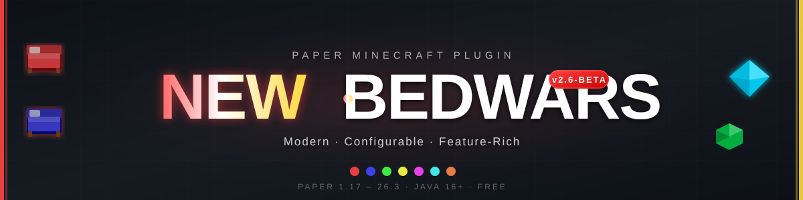

Bedwars for Paper 1.17 to 26.x. Arenas are built and configured in-game, the shop, scoreboards and boss bars are YAML files, and the same plugin runs on a single server or behind a Velocity proxy.

[](https://modrinth.com/plugin/new-bedwars)
[](https://github.com/l299l/NewBedwars-Free)

[](https://modrinth.com/plugin/new-bedwars/versions)


[](LICENSE.txt)

</div>

NewBedwars is in beta. Gameplay is stable; please report problems on the [issue tracker](https://github.com/l299l/NewBedwars-Free/issues).

## Overview

Most free Bedwars plugins are either very basic or need a pile of other plugins and a huge config. NewBedwars tries to stay in between: install the jar, run `/bw arena create`, and a setup checklist walks you through the rest. PlaceholderAPI, WorldEdit and Citizens are supported but never required.

Arena files are saved atomically with rotating backups, every game starts from a pristine copy of the map, and a player data file that cannot be read is moved aside instead of being overwritten.

## Features

- Several arenas at once, each in its own world, with configurable teams, generators, upgrades, traps and custom shop items (golems, silverfish, bridge eggs and more)
- Rejoin after a disconnect, spectator mode with a player compass, quick void, build protection zones
- Arena groups with map voting at the end of a game, and `/bw arena copy` to run one map in several games
- Parties (`/party`) with clickable invites
- Per-arena chat, team chat with `!message`, tab list isolation
- YAML boss bars and scoreboards with placeholders
- English, Polish, German, Spanish, French and Russian; missing keys fall back to English
- Arena backup, restore, export, import and map reset commands
- JSON storage by default, or MySQL/MariaDB shared between servers
- Velocity network mode with lobby and game servers
- A read-only addon API with events

Optional integrations:

| Plugin | Used for |
|---|---|
| PlaceholderAPI | 34 `%newbedwars_*%` placeholders for players, stats, arenas and groups |
| WorldEdit / FastAsyncWorldEdit | Creating an arena from a `.schem` file |
| Citizens | Lobby join NPCs with a live hologram (without it, `/bw npc create` spawns a simple NPC) |

## Requirements

- Paper 1.17 to 26.x (Spigot is untested)
- Java 16 or newer, or whatever your Paper version needs
- For network mode: Velocity 4.x running on Java 25, and the same NewBedwars version on every server

## Installation

1. Download the jar from the [latest release](https://modrinth.com/plugin/new-bedwars/versions) and put it in `plugins/`.
2. Start the server so the configs are generated.
3. `/bw setlobby` at your lobby spawn.
4. `/bw arena create myArena`, then follow the checklist shown by `/bw arena`.
5. `/bw save`, then `/bw arena enable myArena`.
6. Players join with `/bw join myArena`.

To build the arena from a schematic, put the `.schem` in the WorldEdit (or FAWE) `schematics` folder and use `/bw arena create myArena -sche myMap`. The map is pasted at the world origin and you continue with the same checklist.

Commands and permissions are listed in [docs/COMMANDS.md](docs/COMMANDS.md).

## Network mode

Lobby servers let players pick a game; game servers host the arenas. The proxy plugin routes players and parties to the fullest free arena, sends them back to a lobby after the game, and handles rejoin and spectating from the lobby.

```
Players -> Velocity + NewBedwars-Proxy -> Lobby servers  (Network.Mode: LOBBY)
                                       -> Game servers   (Network.Mode: GAME)

Optional: MySQL/MariaDB for shared stats and server status
```

Put `NewBedwars-Proxy` on Velocity, the normal jar on every backend, set `Network.Mode` in each backend's `config.yml`, and use Velocity modern forwarding. Backend ports must not be reachable from the internet. Full setup, config and security notes are in [docs/NETWORK.md](docs/NETWORK.md).

## Documentation

- [Commands and permissions](docs/COMMANDS.md)
- [Placeholders](docs/PLACEHOLDERS.md)
- [Storage (JSON and MySQL)](docs/STORAGE.md)
- [Network mode](docs/NETWORK.md)
- [Addon API](docs/API.md)
- [Changelog](CHANGELOG.md)

## Addon API

[](https://jitpack.io/#l299l/NewBedwars-Free)

Addons can read arenas, teams and players, listen to events, edit arenas that are waiting, and register shop logic, upgrades, armor tiers, commands and phase actions. Only the `com.l299l.newbedwars.api` package is stable. The full guide is [docs/API.md](docs/API.md).

<details>
<summary>Example and event list</summary>

**1. Add the dependency** (published through [JitPack](https://jitpack.io/#l299l/NewBedwars-Free); available from the first release that contains the API):

```xml
<repositories>
    <repository>
        <id>jitpack.io</id>
        <url>https://jitpack.io</url>
    </repository>
</repositories>

<dependencies>
    <dependency>
        <groupId>com.github.l299l.NewBedwars-Free</groupId>
        <artifactId>newbedwars-api</artifactId>
        <version>v2.6-beta</version> <!-- a release tag -->
        <scope>provided</scope>
    </dependency>
</dependencies>
```

**2. Depend on it** in your `plugin.yml`: `depend: [NewBedwars]`.

**3. Use it:**

```java
public class MyAddon extends JavaPlugin implements Listener {
    @Override
    public void onEnable() {
        getServer().getPluginManager().registerEvents(this, this);
        NewBedwarsAPI api = NewBedwarsAPI.get(); // read-only views of arenas, teams and players
        getLogger().info("Arenas: " + api.getArenas().size());
    }

    @EventHandler
    public void onBedBreak(BedBreakEvent e) {
        e.getArena().getPlayers().forEach(p -> p.sendMessage(e.getBreaker().getName() + " broke " + e.getTeam().getName() + "'s bed!"));
    }

    @EventHandler
    public void onKill(PlayerKillEvent e) {
        if (e.isFinalKill()) getLogger().info(e.getVictim().getName() + " was eliminated");
    }
}
```

| Event | Cancellable | Fired |
|---|---|---|
| `GameStartEvent` / `GameEndEvent` | no | game starts (teams assigned) / ends (winner or draw) |
| `ArenaResetEvent` | no | before (`PRE`) and after (`POST`) the map is reset |
| `PlayerJoinArenaEvent` | yes | before a player joins or rejoins |
| `PlayerLeaveArenaEvent` | no | a player or spectator leaves (with a `LeaveReason`) |
| `BedBreakEvent` | yes | before an enemy bed is destroyed |
| `PlayerKillEvent` | no | a player dies in a running game |
| `ShopPurchaseEvent` | yes | before a shop purchase is charged |
| `TeamUpgradeEvent` | yes | before a team upgrade or trap is bought |
| `ArmorEquipEvent` | no (armor can be replaced) | before armor is applied |
| `PlayerSendToLobbyEvent` | yes (target can be changed) | whenever the plugin sends a player to the lobby, e.g. to redirect to a lobby server |

</details>

---

## Screenshots

<details>
<summary><b>Joining & Waiting</b></summary>

<table>
  <tr>
    <td align="center">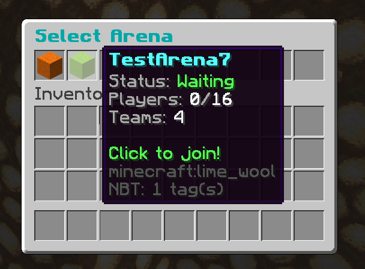<br><sub>Arena selector GUI</sub></td>
    <td align="center">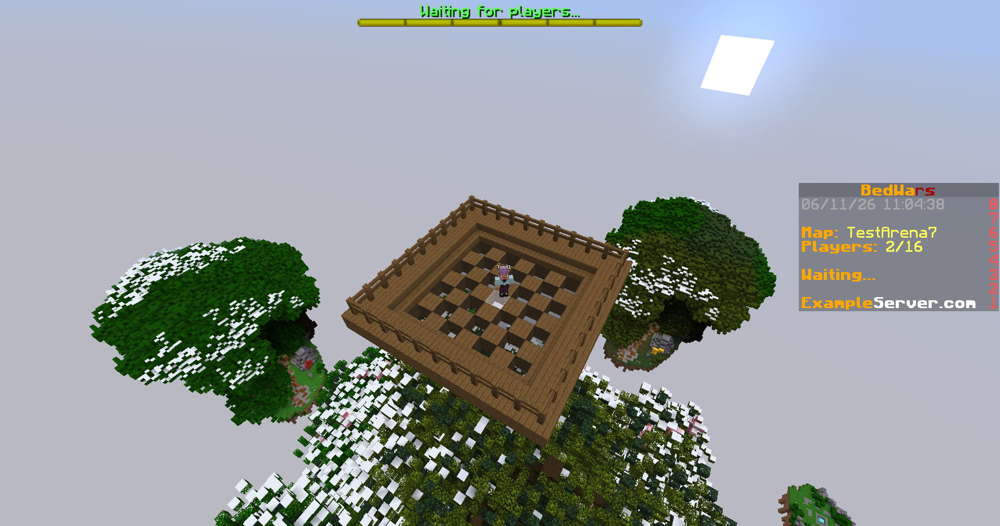<br><sub>Waiting lobby with bossbar & scoreboard</sub></td>
  </tr>
</table>

</details>

<details>
<summary><b>In-Game HUD & Events</b></summary>

<table>
  <tr>
    <td align="center">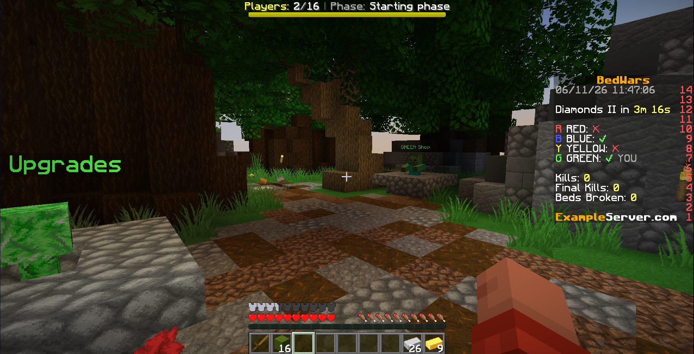<br><sub>In-game HUD, scoreboard, phase info, NPC labels</sub></td>
    <td align="center">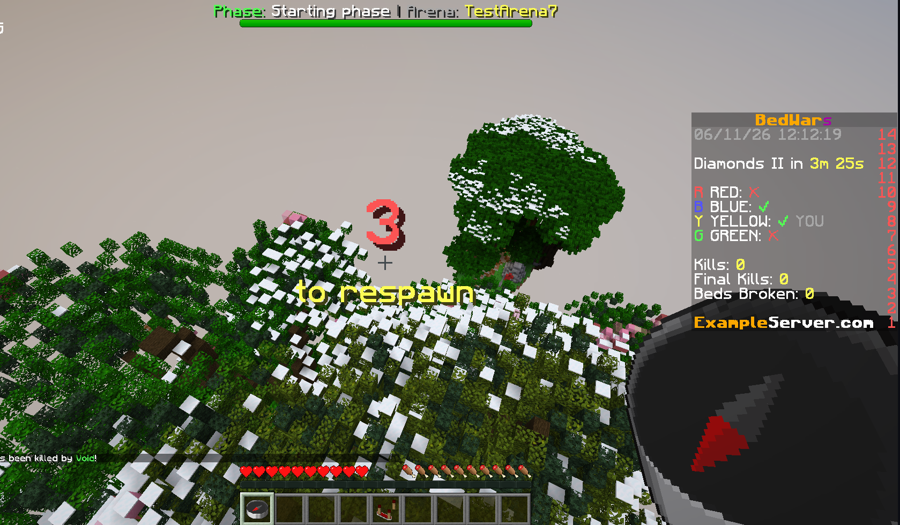<br><sub>Respawn countdown</sub></td>
  </tr>
  <tr>
    <td align="center">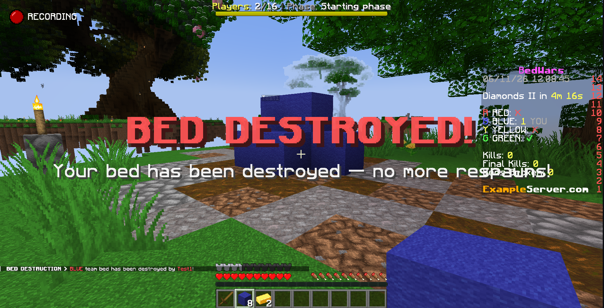<br><sub>Bed destroyed announcement</sub></td>
    <td align="center">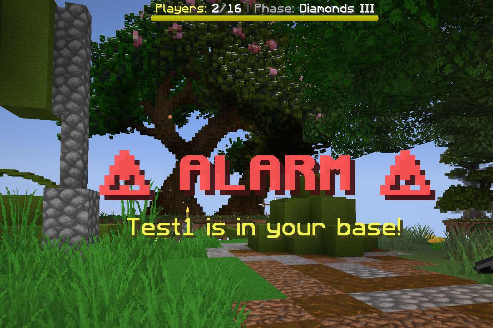<br><sub>Trap alarm</sub></td>
  </tr>
  <tr>
    <td align="center">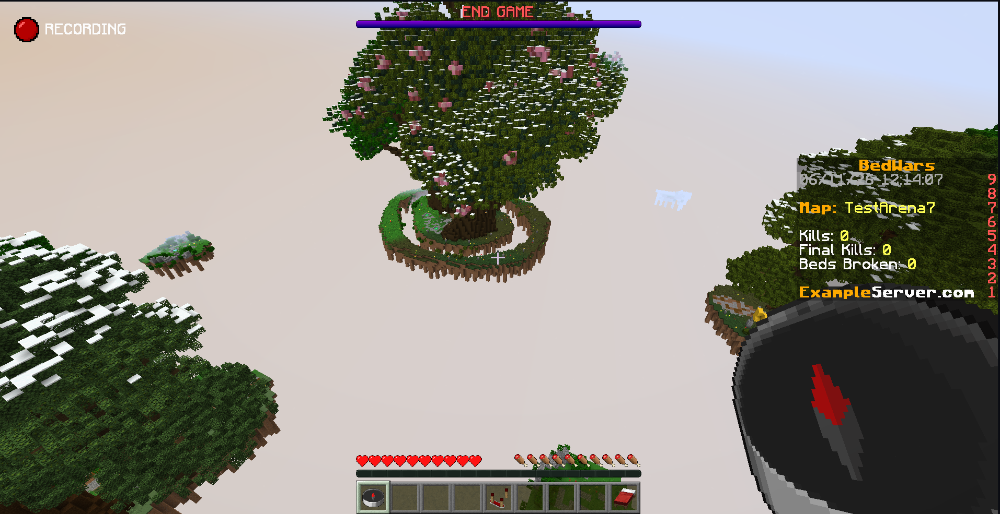<br><sub>End game, spectator view with bossbar</sub></td>
    <td></td>
  </tr>
</table>

</details>

<details>
<summary><b>Shop & Upgrades</b></summary>

<table>
  <tr>
    <td align="center">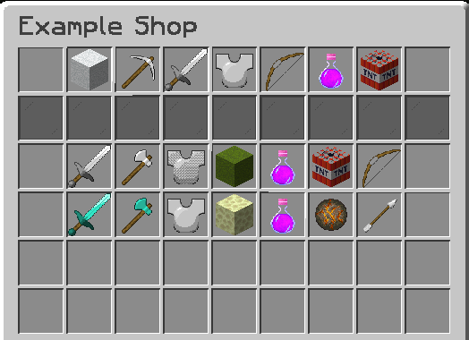<br><sub>Shop GUI</sub></td>
    <td align="center">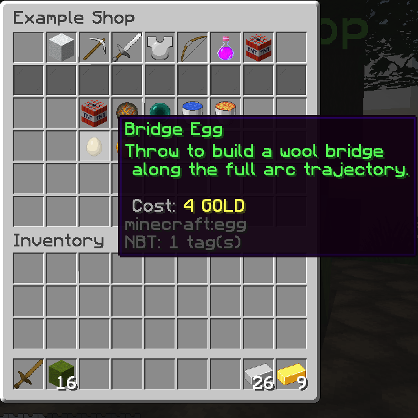<br><sub>Bridge Egg, shop tooltip (cost: 4 Gold)</sub></td>
  </tr>
  <tr>
    <td align="center">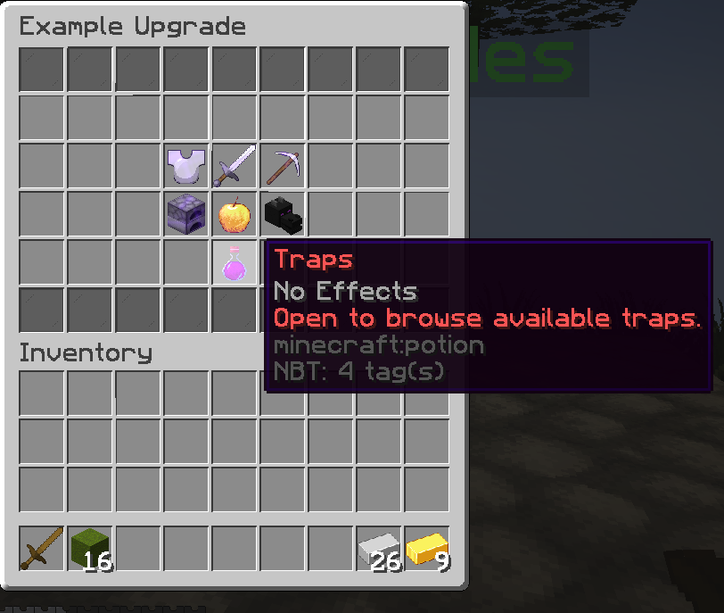<br><sub>Team Upgrades shop</sub></td>
    <td></td>
  </tr>
</table>

</details>

<details>
<summary><b>Resource Generators</b></summary>

<table>
  <tr>
    <td align="center">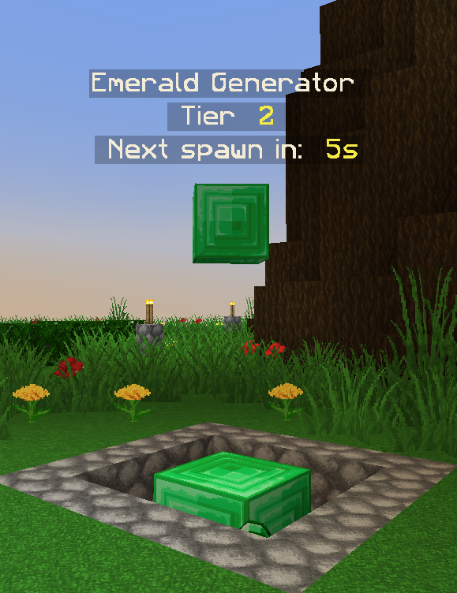<br><sub>Emerald Generator, hologram</sub></td>
    <td align="center">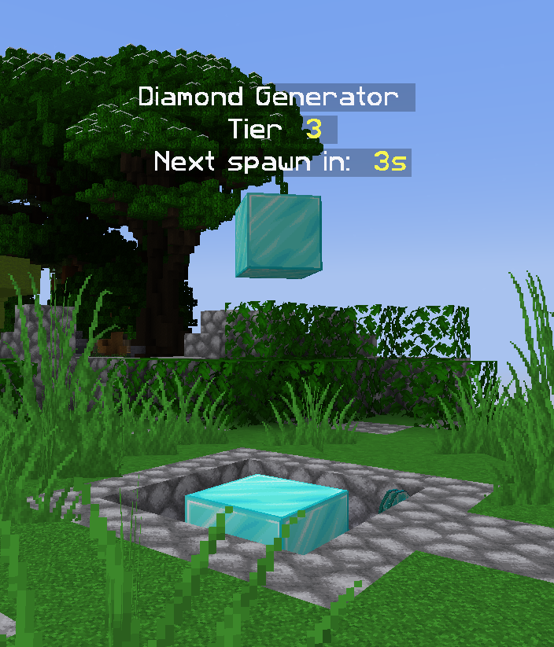<br><sub>Diamond Generator, hologram</sub></td>
  </tr>
</table>

</details>

<details>
<summary><b>Arena Setup</b></summary>

<table>
  <tr>
    <td align="center">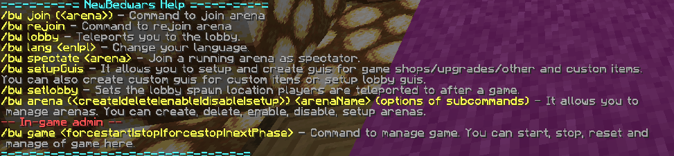<br><sub>Help command output</sub></td>
    <td align="center">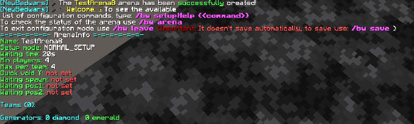<br><sub>Arena setup checklist (NORMAL_SETUP)</sub></td>
  </tr>
  <tr>
    <td align="center">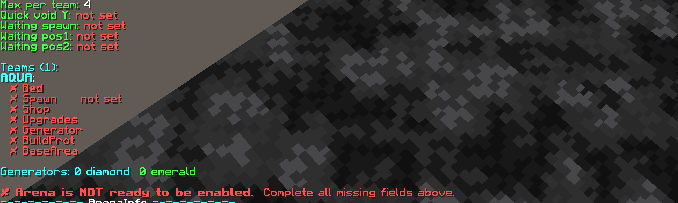<br><sub>Team configuration checklist, missing fields highlighted</sub></td>
    <td></td>
  </tr>
</table>

</details>

<details>
<summary><b>Map & Environment</b></summary>

<table>
  <tr>
    <td align="center">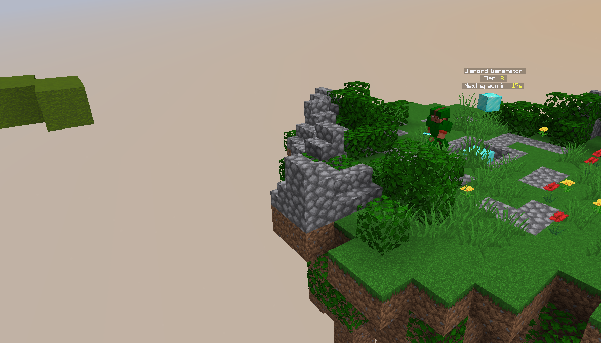<br><sub>Arena map, aerial overview</sub></td>
    <td align="center">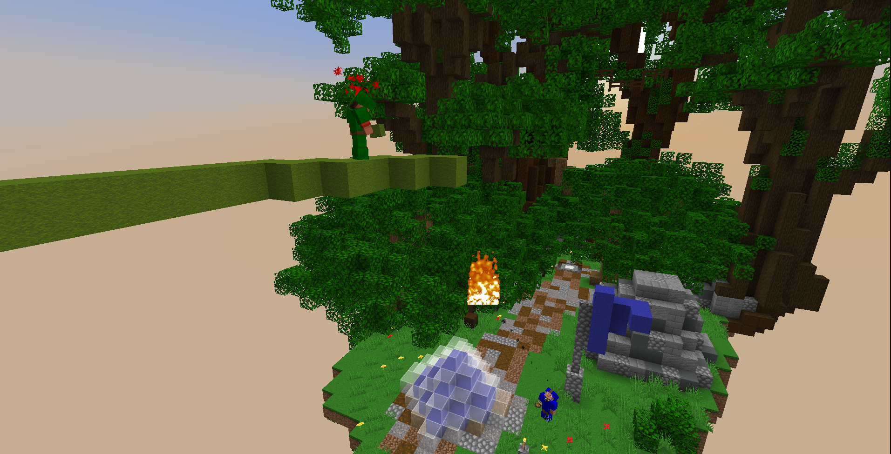<br><sub>Live gameplay, combat near a bed 1</sub></td>
  </tr>
  <tr>
    <td align="center">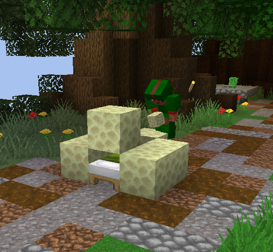<br><sub>Live gameplay, bed protection</sub></td>
    <td align="center">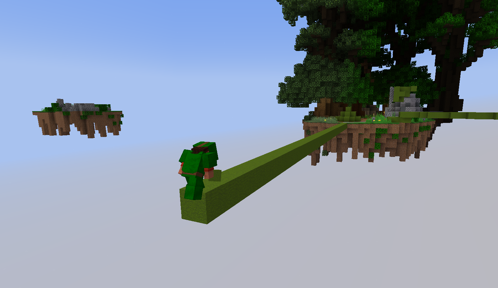<br><sub>Live gameplay, building bridge</sub></td>
  </tr>
  <tr>
    <td align="center">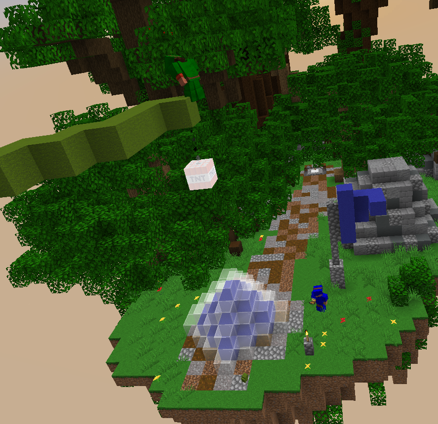<br><sub>Live gameplay, combat near a bed 2</sub></td>
    <td></td>
  </tr>
</table>

</details>

---

---

## Building

```bash
mvn package                              # all modules
mvn -pl newbedwars-plugin -am package    # only the Paper plugin
mvn test
```

The modules are `newbedwars-api`, `newbedwars-common`, `newbedwars-plugin` (Paper, Java 16 bytecode) and `newbedwars-proxy` (Velocity, Java 25). Use JDK 25 or newer to build everything. Artifacts: `newbedwars-plugin/target/NewBedwars-<version>.jar` and `newbedwars-proxy/target/NewBedwars-Proxy-<version>.jar`.

---

## Roadmap

NewBedwars leaves beta once it has been verified on all supported server versions. A website panel is still planned; everything else on the old roadmap (parties, PlaceholderAPI, schematics, stats, addon API, Citizens NPCs, map voting, network mode) is done.

---

## Support

Open an issue on [GitHub](https://github.com/l299l/NewBedwars-Free/issues). Please include your server version, the NewBedwars version, and the relevant part of `logs/latest.log`.

## License

GNU GPL v3. See [LICENSE.txt](LICENSE.txt).

---

NewBedwars by l299l.
