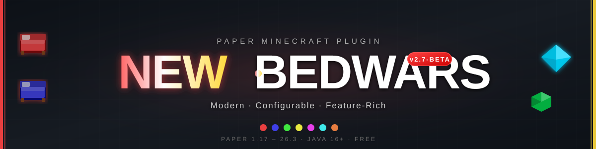

<div align="center">

[](https://modrinth.com/plugin/new-bedwars) [](https://github.com/l299l/NewBedwars-Free) [](https://github.com/l299l/NewBedwars-Free/blob/master/docs/PANEL.md)

</div>

# NewBedwars Panel

A web admin panel for [NewBedwars](https://modrinth.com/plugin/new-bedwars). Drop the jar next to NewBedwars, create an account from the console, and manage your Bedwars server from any browser: live arenas, game control, game logs, player stats and a visual shop editor. It even works across a whole network of servers.

The panel runs inside your Paper server. You don't need a separate website, database or extra program, and it speaks HTTPS out of the box.

> **This is an addon.** It needs **NewBedwars** of the **same version** on the same server. It is a beta, like NewBedwars itself. Please report issues on [GitHub](https://github.com/l299l/NewBedwars-Free/issues).

## Features

**Arenas, live**
- Every arena at a glance: state, players, current phase with time left and the next phase, game time, each team's bed
- Online players, TPS and memory
- Enable, disable, back up, restore, reset the map, copy, export (download as zip) and delete arenas
- Import arena zips you upload, so you can move maps between servers in a few clicks

**Game control and game log**
- Start the countdown, start now, skip to the next phase, end as a draw, stop and reset
- Broadcast a message (with `&` colours) to everyone in an arena
- A live game log per arena: joins and leaves, chat and team chat, kills and final kills with the real death reason (void, dragon, fall, ...), beds, phases, generator upgrades, eliminated teams, and commands used inside the arena

**Player stats**
- Look up any player's stats, online or offline
- Leaderboards: top 10, 25 or 100 by wins, kills, final kills, beds, deaths, losses or games played
- Works with both JSON and MySQL storage

**Shop editor**
- Edit every shop item: material, amount, price and currency, what buying does, item logic, enchantments, flags and permission
- Names, icon descriptions and lore in every language, with a live colour-code preview
- Build shop and upgrade menus on a visual slot grid with drag and drop, categories and header and footer rows
- Upgrade and trap prices per level, each with its own currency, plus cheaper or pricier prices per upgrade menu (for example for solo arenas)
- Pick the shop and upgrade menu of each arena
- Changes apply at once, with no reload. Items still in use can't be deleted, and the previous version of every file is backed up automatically

**Accounts, roles and activity log**
- One account per person, created from the console with a one-time password that must be changed at the first login
- Built-in `admin` and `staff` (view only) roles, plus your own roles from 18 permissions
- Nobody can grant more than they have, so a moderator can't make themselves an admin
- Accounts are locked after repeated wrong passwords, and every action is written to an activity log
- English and Polish interface, phone-friendly

**Network mode**
- Run one panel on the lobby (gateway) and one on every game server (nodes), connected with a shared secret
- One login on the lobby panel shows every server (status, players, TPS, arenas) and opens any arena, game log, shop editor, stats and arena import/export of any game server
- Copy shop items, menus and upgrade prices from one server to all the others with one click
- Game servers only answer their own gateway: requests are signed, protected against replay, and certificates are pinned on first contact

## Screenshots

<details>
<summary>Arenas & Game Control</summary>

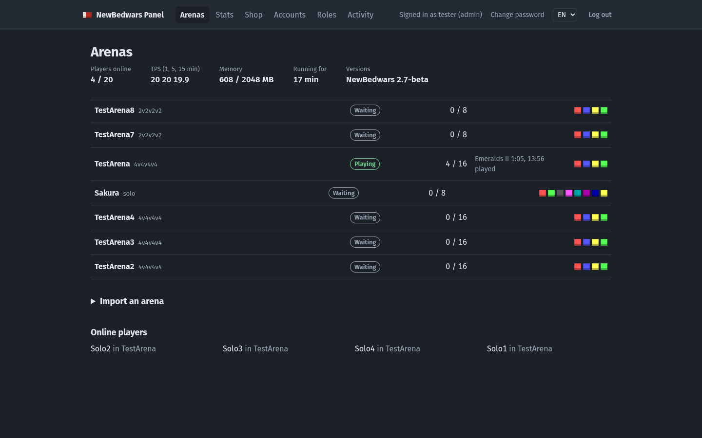
*Dashboard: live arenas, players, TPS*

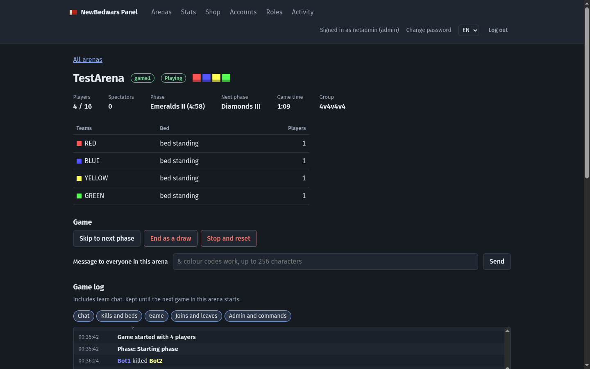
*Arena view with game control*

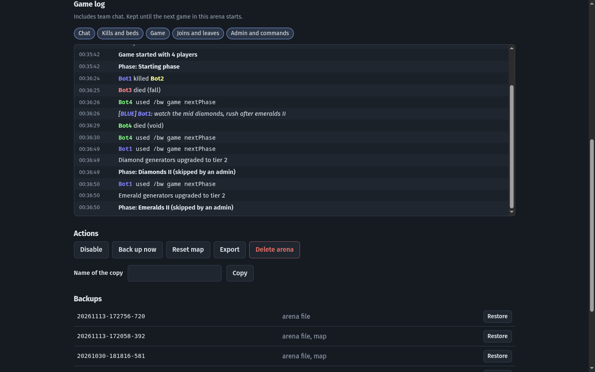
*Live game log*

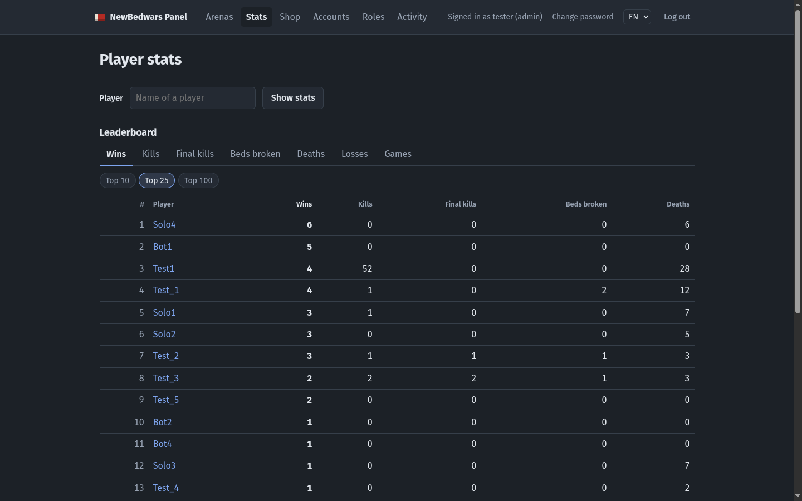
*Player stats and leaderboards*

</details>

<details>
<summary>Shop Editor</summary>

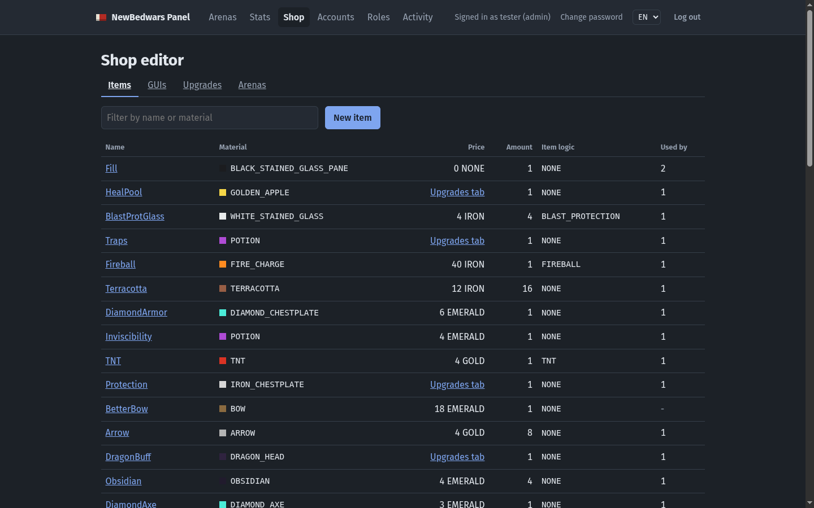
*Shop items*

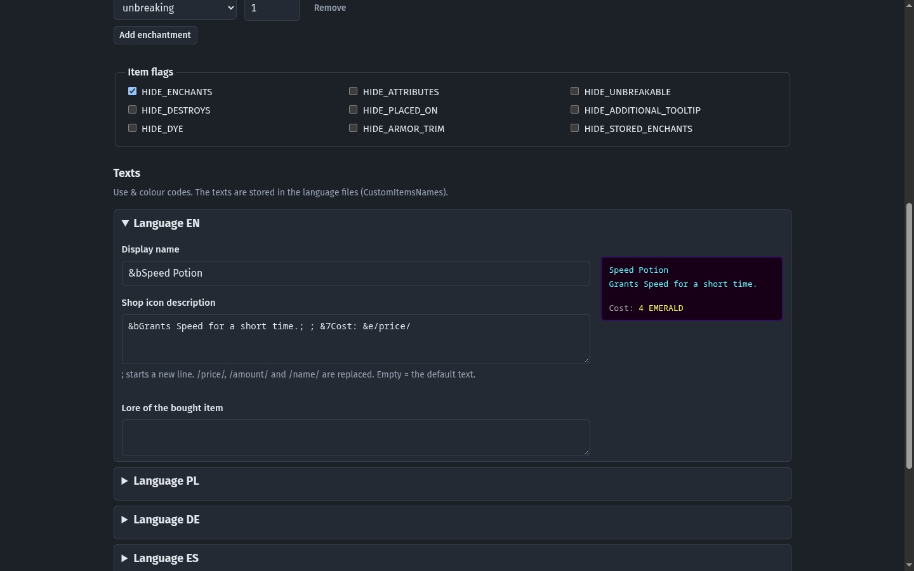
*Shop item editor*

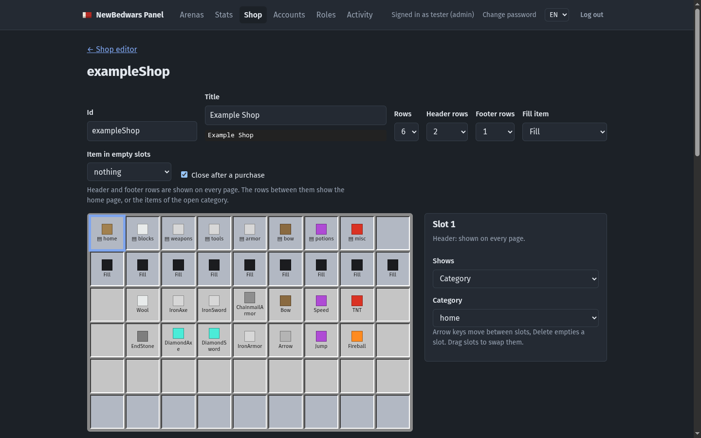
*Shop GUI editor (drag and drop)*

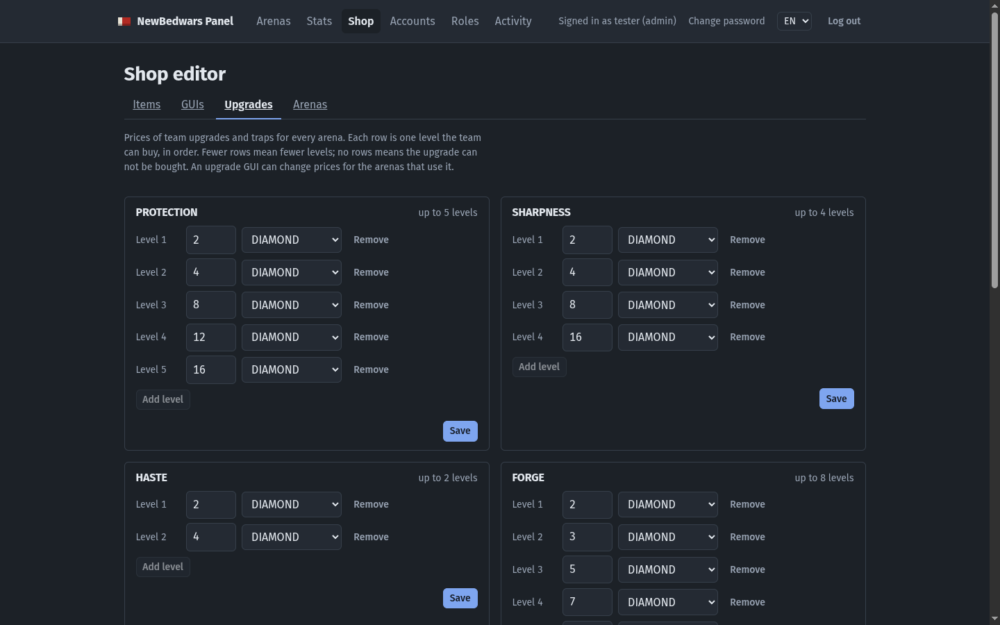
*Upgrade and trap prices*

</details>

<details>
<summary>Accounts, Network & Phone</summary>

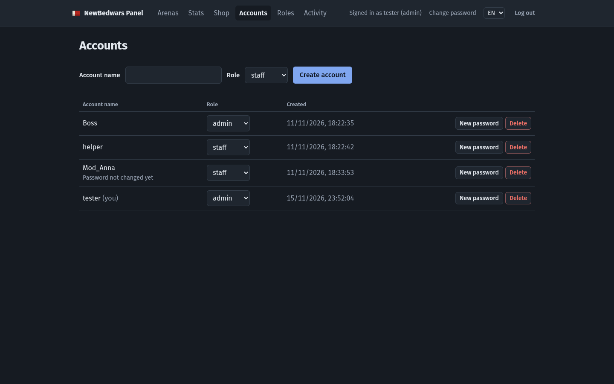
*Accounts and roles*

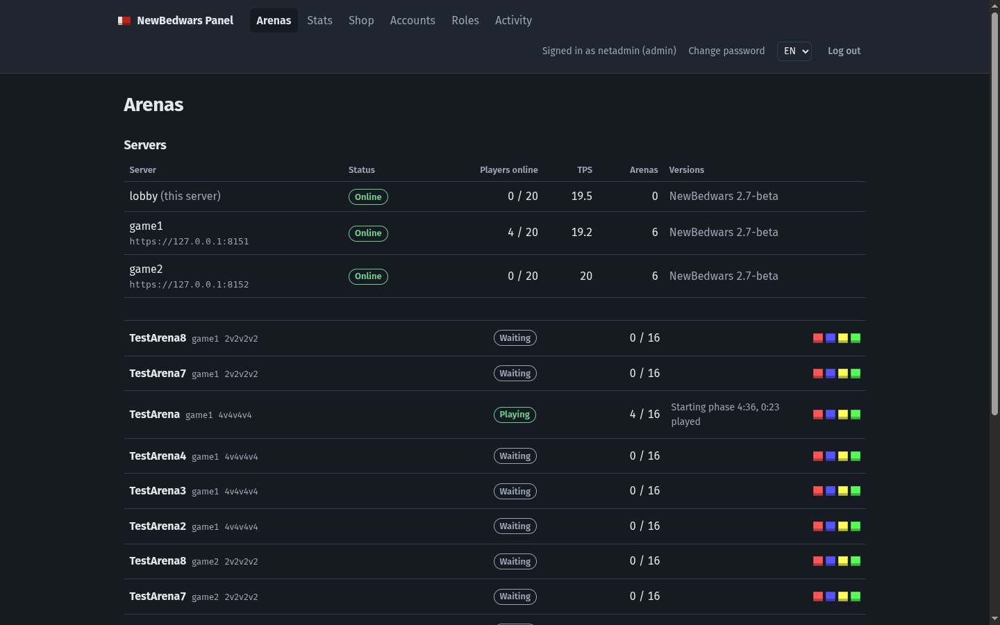
*Network: every server on one panel*

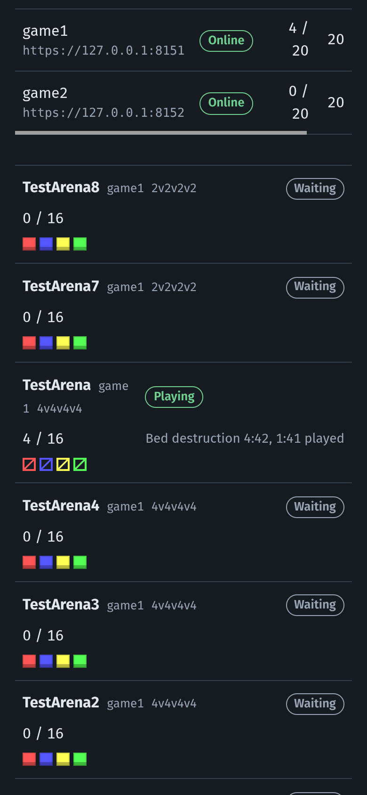
*Phone view*

</details>

## Security

- HTTPS by default, with a self-signed certificate created automatically. Your own certificate or a reverse proxy (nginx, Caddy) also works.
- Passwords are hashed with PBKDF2 (600 000 rounds), and the account file is encrypted.
- Session cookies are `HttpOnly` and `SameSite=Strict`, with CSRF protection on every change.
- The page loads nothing from other sites: no CDN, no fonts, no tracking.
- Every permission is checked by the server, not just hidden in the page.

## Requirements

- **NewBedwars 2.7-beta or newer**, the same version as this jar
- **Server:** Paper 1.17 – 26.x
- **Java:** a standard JDK/JRE (e.g. Eclipse Temurin), which includes the built-in web server
- One free TCP port (8150 by default)

## Getting started

1. Put `NewBedwars-Panel-<version>.jar` into `plugins/` next to `NewBedwars-<version>.jar`, then start the server.
2. Create the first account in the console:
   ```
   nbwpanel user create <name> admin
   ```
   The answer shows a one-time password.
3. Open `https://<your-server>:8150/`. The browser warns once about the self-signed certificate. You can compare its fingerprint with `nbwpanel status`. Log in and choose your own password.
4. Open port 8150 in your firewall if you want to reach the panel from another computer.

The full guide covers roles, your own certificate, reverse proxies, network mode and troubleshooting: **[docs/PANEL.md](https://github.com/l299l/NewBedwars-Free/blob/master/docs/PANEL.md)**

## Commands

| Command | What it does |
|---|---|
| `/nbwpanel status` | Address, certificate fingerprint, accounts and sessions |
| `/nbwpanel user create <name> <role>` | New account with a one-time password |
| `/nbwpanel user reset <name>` | New one-time password, logs the user out everywhere |
| `/nbwpanel user delete <name>` / `user list` | Delete an account / list accounts with their role |
| `/nbwpanel network status` | Network role and, on a gateway, every server's status |
| `/nbwpanel network secret` | Print a new random shared secret for network mode |
| `/nbwpanel network forget <server>` | Accept a game server's new certificate |

Commands work from the console, or in game for players with `newbedwars.panel.manage`.
