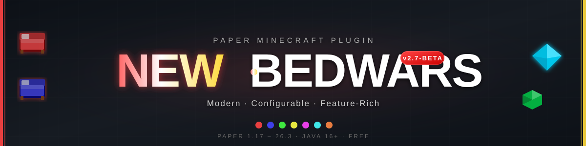
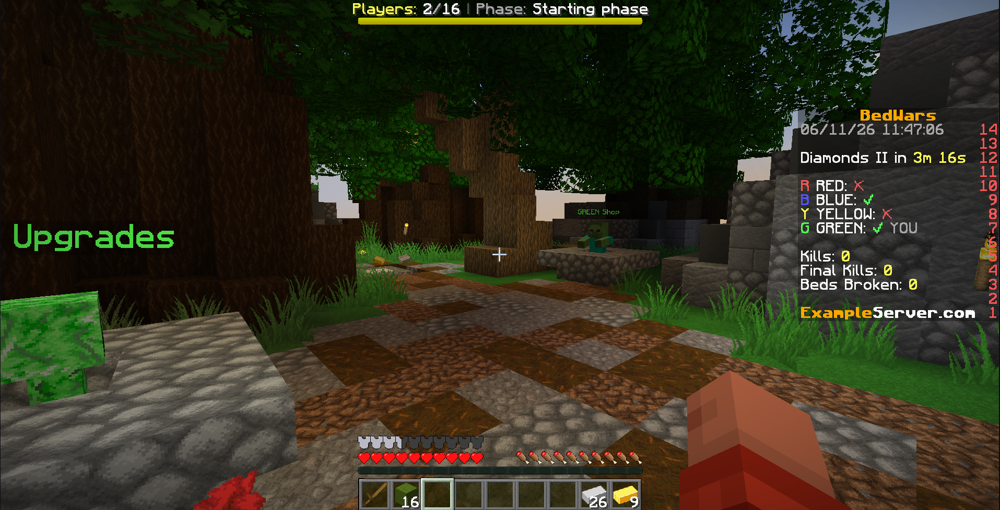
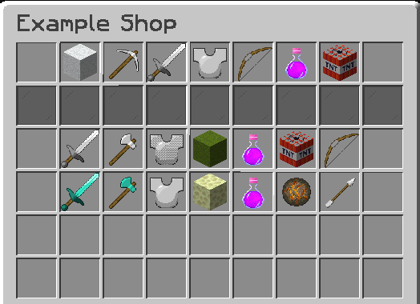
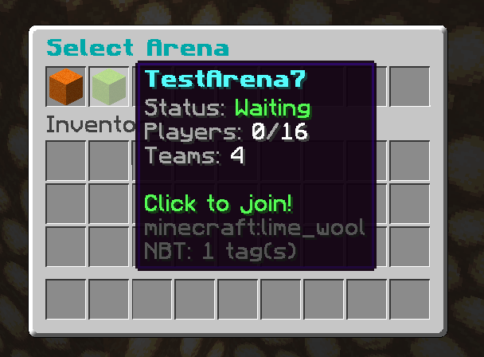
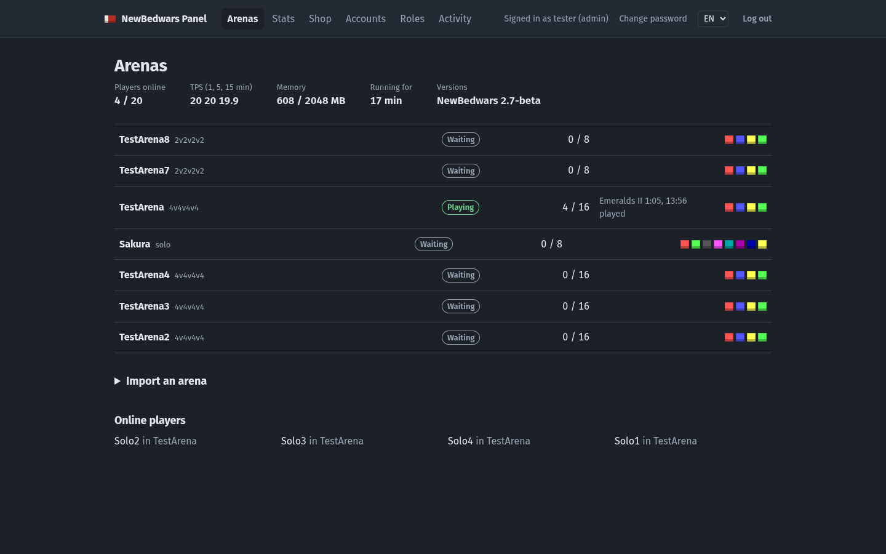

# NewBedwars

NewBedwars is a free Bedwars plugin for **Paper 1.17 to 26.x**. Arenas are built and configured in-game, the shop, scoreboards and boss bars are YAML files, and the same plugin runs on a single server or behind a Velocity proxy. PlaceholderAPI, WorldEdit and Citizens are supported but never required.

[Download on Modrinth](https://modrinth.com/plugin/new-bedwars){ .md-button .md-button--primary }
[Source on GitHub](https://github.com/l299l/NewBedwars-Free){ .md-button }

!!! note "Beta"
    NewBedwars is in beta, close to its first stable release. Gameplay is stable; please report problems on the [issue tracker](https://github.com/l299l/NewBedwars-Free/issues).

## Where to start

- **[Installation](installation.md)**: requirements, first start and updates.
- **[Arena setup](arena-setup.md)**: build your first arena, by hand or with the automatic setup.
- **[Shop and upgrades](shop-and-upgrades.md)**: shop items, shop and upgrade menus, upgrade prices.
- **[Configuration](configuration.md)**: every setting in `config.yml`.
- **[Commands and permissions](commands.md)**: everything players and admins can type.
- **[Web panel](panel.md)**: the optional browser admin panel addon.

## Features

- Several arenas at once, each in its own world, with configurable teams, generators, upgrades, traps and custom shop items (golems, silverfish, bridge eggs and more)
- In-game setup with a checklist, or an automatic setup that finds beds, generators and marker signs for you
- Rejoin after a disconnect, spectator mode with a player compass, quick void, build protection zones
- Arena groups with map voting at the end of a game
- Parties (`/party`) with clickable invites
- Per-arena chat, team chat with `!message`, tab list isolation
- YAML boss bars and scoreboards with placeholders
- English, Polish, German, Spanish, French and Russian
- Arena backup, restore, export, import and map reset; every game starts from a clean copy of the map
- JSON storage by default, or MySQL/MariaDB shared between servers ([Storage](storage.md))
- Velocity network mode with lobby and game servers ([Network mode](network.md))
- Update notifications and `/bw update`
- An [addon API](api.md) with events
- An optional [web admin panel](panel.md)

## Screenshots

## Help and support

- Bugs and feature requests: [GitHub issues](https://github.com/l299l/NewBedwars-Free/issues)
- Changes in every version: [changelog](https://github.com/l299l/NewBedwars-Free/blob/master/CHANGELOG.md)
- License: GPLv3
